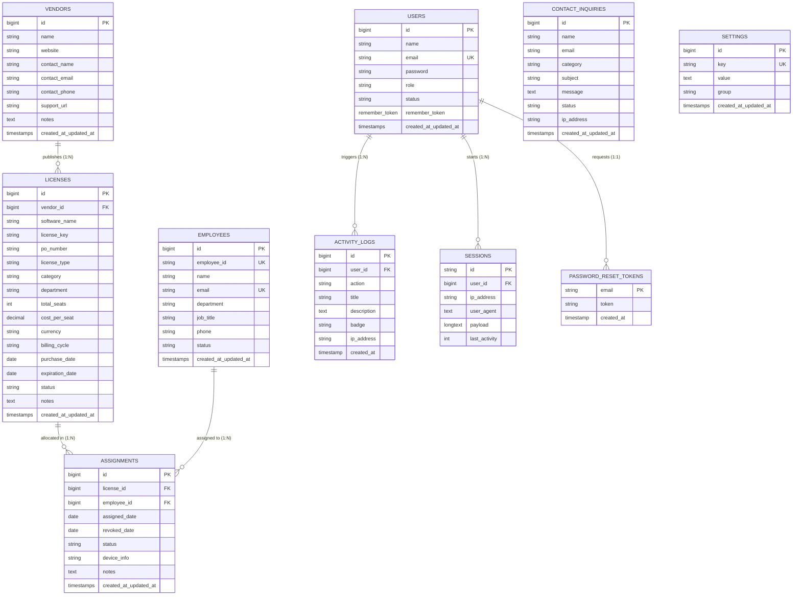

# Milestone 1: Problem Statement, Scope, Database Design & Navigation

> **Project Title:** Software License Management System (*LicenseHub Pro*)  
> **Course / Evaluator:** Laravel Project Development  
> **Milestone:** Milestone - 1 (5 Marks)  
> **Submitted By:** Brijesh Akbari (126302)  
> **Repository Branch:** `milestone-1`

---

## Table of Contents
1. [Problem Statement & Scope](#1-problem-statement--scope)
2. [Modules Breakdown](#2-modules-breakdown)
3. [Database & Table Design (Schema & ERD)](#3-database--table-design)
4. [Required Fields Specification](#4-required-fields-specification)
5. [Page & Navigation Design](#5-page--navigation-design)

---

## 1. Problem Statement & Scope

### 1.1 Problem Statement
Modern businesses and engineering institutions rely heavily on commercial software licenses (e.g., JetBrains IDEs, Microsoft 365, Adobe Creative Cloud, Docker, Figma, Autodesk). However, organizations face critical operational and financial challenges:

1. **Software Sprawl & Shelfware Waste**: Approximately **25%–35%** of purchased software seats remain unassigned or unused (*shelfware*), leading to thousands of dollars wasted annually.
2. **Surprise Expirations & Downtime**: Critical engineering tools expire unexpectedly because renewals are tracked manually across fragmented spreadsheets or individual employee inboxes.
3. **Audit Compliance Penalties**: In the event of a software publisher compliance audit (BSA), organizations without centralized seat allocation logs risk severe legal and financial penalties for unlicensed installations.
4. **Hardware Misplacement**: Organizations lose track of which laptop, workstation, or employee holds expensive perpetual software license keys.

### 1.2 Project Scope
The **Software License Management System** is scoped to provide a centralized, secure administrative web application to:
- **Centralize License Inventory**: Maintain records of software agreements, serial numbers, categories, seat limits, and purchase/expiration dates.
- **Track Publishers & Vendors**: Keep an updated directory of software vendors, support URLs, contact persons, and phone numbers.
- **Manage Seat Allocations**: Allocate seats to employees, bind them to specific hardware device tokens, and log revoking/reallocation.
- **Automate Renewal Warnings**: Provide proactive 30-day urgency radars and quick contract extension actions.
- **Generate Audit Documentation**: Export clean, structured data for IT auditors and financial stakeholders.

---

## 2. Modules Breakdown

The system is organized into **10 distinct functional modules**:

```
┌────────────────────────────────────────────────────────────────────────┐
│                   SOFTWARE LICENSE MANAGEMENT SYSTEM                   │
├────────────────────────┬───────────────────────┬───────────────────────┤
│ 1. Executive Dashboard │ 2. License Inventory  │ 3. Seat Allocation    │
├────────────────────────┼───────────────────────┼───────────────────────┤
│ 4. Vendor Management   │ 5. Staff Directory    │ 6. Renewals Radar     │
├────────────────────────┼───────────────────────┼───────────────────────┤
│ 7. Reports & Analytics │ 8. Audit Activity Log │ 9. System Settings    │
├────────────────────────┴───────────────────────┴───────────────────────┤
│              10. Public Web Portal & Authentication (Home/Auth)        │
└────────────────────────────────────────────────────────────────────────┘
```

### Module Descriptions:

| # | Module Name | Description & Functional Scope |
| :-: | :--- | :--- |
| **1** | **Executive Dashboard** | High-level KPI radar displaying total subscriptions, total seats, staff count, software publishers, calculated Annual Spend, Seat Utilization percentage ($U\%$), and contracts expiring within 30 days. |
| **2** | **Software License Inventory** | Repository of all software licenses. Supports categorizing (Development, Design, Productivity, Cloud, Security), tier classification (Subscription vs Perpetual), and seat limit tracking. |
| **3** | **Seat Allocation & Governance** | Assigns software seats to verified staff members. Records hardware device tags (e.g., MacBook Pro serial, Dell Latitude ID), prevents over-allocation, and logs seat revocations. |
| **4** | **Vendor Directory** | Database of software publishers (e.g., JetBrains, Microsoft, Adobe) with representative contact details, direct support URLs, and contract notes. |
| **5** | **Staff Directory** | Corporate employee directory with badge numbers (`EMP-XXXX`), departments, job titles, and active software counts. |
| **6** | **Contract Renewals Hub** | Dedicated monitoring interface highlighting licenses approaching expiration within 30 days, complete with quick contract extension actions (+1 Month / +1 Year). |
| **7** | **Reports & Analytics** | Statistical breakdowns of license expenditures across departments and vendors, with audit-ready CSV exports. |
| **8** | **Audit Activity Log** | Chronological record of system transactions (seat allocations, revocations, contract renewals, license creations). |
| **9** | **System Settings** | Enterprise configuration for company branding, administrator alert emails, currency selection, and renewal warning windows. |
| **10**| **Public Portal & Authentication**| Public-facing landing page, About Us, Support Contact form, user registration, and secure administrator login/logout. |

---

## 3. Database & Table Design

### 3.1 Entity Relationship Diagram (ERD)



### 3.2 Data Dictionary (Tables & Attributes)

#### Table 1: `vendors` (Software Publishers)
| Column Name | Data Type | Constraints | Description |
| :--- | :--- | :--- | :--- |
| `id` | BIGINT UNSIGNED | Primary Key, Auto-increment | Unique vendor record identifier |
| `name` | VARCHAR(255) | NOT NULL | Official company name (e.g. JetBrains, Microsoft) |
| `website` | VARCHAR(255) | NULLABLE | Vendor official website URL |
| `contact_name` | VARCHAR(255) | NULLABLE | Account manager or representative name |
| `contact_email` | VARCHAR(255) | NULLABLE | Vendor sales or support email |
| `contact_phone` | VARCHAR(50) | NULLABLE | Representative hotline / phone number |
| `support_url` | VARCHAR(255) | NULLABLE | Dedicated customer support portal URL |
| `notes` | TEXT | NULLABLE | Contract notes, renewal terms |
| `created_at` / `updated_at` | TIMESTAMP | NULLABLE | System audit timestamps |

#### Table 2: `employees` (Staff Members)
| Column Name | Data Type | Constraints | Description |
| :--- | :--- | :--- | :--- |
| `id` | BIGINT UNSIGNED | Primary Key, Auto-increment | Internal employee identifier |
| `employee_id` | VARCHAR(100) | UNIQUE, NOT NULL | Corporate badge / payroll ID (`EMP-1001`) |
| `name` | VARCHAR(255) | NOT NULL | Full name of the employee |
| `email` | VARCHAR(255) | UNIQUE, NOT NULL | Corporate work email address |
| `department` | VARCHAR(100) | NOT NULL | Department (Engineering, Design, QA, IT) |
| `job_title` | VARCHAR(100) | NOT NULL | Job role / designation |
| `phone` | VARCHAR(50) | NULLABLE | Contact phone number |
| `status` | VARCHAR(50) | DEFAULT 'active' | Employment status (`active`, `inactive`) |
| `created_at` / `updated_at` | TIMESTAMP | NULLABLE | System audit timestamps |

#### Table 3: `licenses` (Software Agreements)
| Column Name | Data Type | Constraints | Description |
| :--- | :--- | :--- | :--- |
| `id` | BIGINT UNSIGNED | Primary Key, Auto-increment | Unique software license ID |
| `vendor_id` | BIGINT UNSIGNED | Foreign Key &rarr; `vendors.id` | Software vendor reference |
| `software_name` | VARCHAR(255) | NOT NULL | Application name (e.g. IntelliJ IDEA, Adobe CC) |
| `license_key` | VARCHAR(255) | NULLABLE | License key, serial, or activation code |
| `po_number` | VARCHAR(100) | NULLABLE | Purchase order / invoice reference |
| `license_type` | VARCHAR(100) | DEFAULT 'Subscription' | Subscription, Perpetual, Enterprise, Trial |
| `category` | VARCHAR(100) | NULLABLE, INDEX | Development, Design, Productivity, Cloud |
| `department` | VARCHAR(100) | NULLABLE | Assigned cost center / department |
| `total_seats` | INT | NOT NULL, DEFAULT 1 | Total seat capacity purchased |
| `cost_per_seat`| DECIMAL(10,2) | NOT NULL, DEFAULT 0.00 | Cost per individual seat |
| `currency` | VARCHAR(10) | DEFAULT 'USD' | Currency code (USD, EUR, GBP, INR) |
| `billing_cycle`| VARCHAR(50) | DEFAULT 'annually' | monthly, annually, quarterly, one-time |
| `purchase_date`| DATE | NOT NULL | Date contract or license was purchased |
| `expiration_date`| DATE | NULLABLE | Contract expiry date (NULL for Perpetual) |
| `status` | VARCHAR(50) | DEFAULT 'active', INDEX | active, expiring_soon, expired, suspended |
| `notes` | TEXT | NULLABLE | Internal licensing notes |
| `created_at` / `updated_at` | TIMESTAMP | NULLABLE | System audit timestamps |

#### Table 4: `assignments` (Seat Allocations)
| Column Name | Data Type | Constraints | Description |
| :--- | :--- | :--- | :--- |
| `id` | BIGINT UNSIGNED | Primary Key, Auto-increment | Unique assignment record ID |
| `license_id` | BIGINT UNSIGNED | Foreign Key &rarr; `licenses.id` | Software license allocated |
| `employee_id` | BIGINT UNSIGNED | Foreign Key &rarr; `employees.id` | Staff member receiving seat |
| `assigned_date`| DATE | NOT NULL | Date seat was allocated |
| `revoked_date` | DATE | NULLABLE | Date seat was revoked / returned |
| `status` | VARCHAR(50) | DEFAULT 'active', INDEX | active, revoked |
| `device_info` | VARCHAR(255) | NULLABLE | Workstation hostname, serial, or MAC ID |
| `notes` | TEXT | NULLABLE | Allocation reason or ticket reference |
| `created_at` / `updated_at` | TIMESTAMP | NULLABLE | System audit timestamps |

#### Table 5: `users` (Login Credentials & User Accounts)
| Column Name | Data Type | Constraints | Description |
| :--- | :--- | :--- | :--- |
| `id` | BIGINT UNSIGNED | Primary Key, Auto-increment | Unique user account ID |
| `name` | VARCHAR(255) | NOT NULL | User's full name |
| `email` | VARCHAR(255) | UNIQUE, NOT NULL | Login email address (credential username) |
| `email_verified_at`| TIMESTAMP | NULLABLE | Email verification timestamp |
| `password` | VARCHAR(255) | NOT NULL | Encrypted password hash (Bcrypt / Argon2) |
| `role` | VARCHAR(50) | DEFAULT 'admin' | User permission role (`super_admin`, `admin`, `viewer`) |
| `status` | VARCHAR(50) | DEFAULT 'active' | Account state (`active`, `suspended`, `pending`) |
| `remember_token` | VARCHAR(100) | NULLABLE | "Remember Me" persistent authentication token |
| `created_at` / `updated_at` | TIMESTAMP | NULLABLE | Account creation and last profile modification |

#### Table 6: `password_reset_tokens` (Forgot Password / Password Recovery)
| Column Name | Data Type | Constraints | Description |
| :--- | :--- | :--- | :--- |
| `email` | VARCHAR(255) | Primary Key, Foreign Key &rarr; `users.email` | User email requesting password reset |
| `token` | VARCHAR(255) | NOT NULL | Cryptographic HMAC SHA-256 secure reset token |
| `created_at` | TIMESTAMP | NULLABLE | Token generation timestamp (used for 60-min expiry check) |

#### Table 7: `sessions` (Login Session Management & Device Tracking)
| Column Name | Data Type | Constraints | Description |
| :--- | :--- | :--- | :--- |
| `id` | VARCHAR(255) | Primary Key | Unique random session identifier |
| `user_id` | BIGINT UNSIGNED | NULLABLE, Foreign Key &rarr; `users.id` | Authenticated user ID (NULL for guest visitors) |
| `ip_address` | VARCHAR(45) | NULLABLE | Client IPv4 / IPv6 address |
| `user_agent` | TEXT | NULLABLE | Browser client, OS, and device string |
| `payload` | LONGTEXT | NOT NULL | Serialized and encrypted session state payload |
| `last_activity` | INTEGER | NOT NULL, INDEX | Unix timestamp of user's most recent HTTP request |

---

## 4. Required Fields Specification

Every form in the application enforces strict validation boundaries:

### Form 1: Add/Edit Software License (`licenses`)
- **Required Fields**:
  - `software_name`: Text, mandatory, max 255 chars.
  - `vendor_id`: Dropdown selection, mandatory (must exist in `vendors`).
  - `license_type`: Selection (`Subscription`, `Perpetual`, `Per Seat`, `Enterprise`).
  - `total_seats`: Integer, mandatory, minimum value = `1`.
  - `cost_per_seat`: Numeric decimal, mandatory, minimum value = `0.00`.
  - `billing_cycle`: Selection (`monthly`, `annually`, `quarterly`, `one-time`).
  - `purchase_date`: Date, mandatory.
  - `expiration_date`: Date, mandatory for Subscriptions (must be $\ge$ `purchase_date`).
- **Optional Fields**: `license_key`, `po_number`, `category`, `department`, `notes`.

### Form 2: Assign Seat to Employee (`assignments`)
- **Required Fields**:
  - `license_id`: Dropdown selection, mandatory (must have available capacity $\gt 0$).
  - `employee_id`: Dropdown selection, mandatory (must exist in `employees`).
  - `assigned_date`: Date, mandatory.
  - `device_info`: Text, mandatory (workstation / device hostname tag).
- **Optional Fields**: `notes`.

### Form 3: Register/Edit Vendor (`vendors`)
- **Required Fields**:
  - `name`: Text, mandatory, max 255 chars.
- **Optional Fields**: `website` (valid URL format), `contact_name`, `contact_email` (valid email format), `contact_phone`, `support_url` (valid URL format), `notes`.

### Form 4: Register Staff Member (`employees`)
- **Required Fields**:
  - `employee_id`: Text, mandatory, unique across system (e.g. `EMP-1001`).
  - `name`: Text, mandatory, max 255 chars.
  - `email`: Email, mandatory, unique across system.
  - `department`: Dropdown/Text, mandatory (e.g. `Engineering`).
  - `job_title`: Text, mandatory (e.g. `Senior Developer`).
- **Optional Fields**: `phone`, `status`.

### Form 5: User Sign In / Login Credentials (`/login`)
- **Required Fields**:
  - `email`: Text / Email format, mandatory (`required|email`).
  - `password`: Password format, mandatory (`required|string`).
- **Optional Fields**:
  - `remember`: Checkbox boolean (keeps session active for 30 days via `remember_token`).

### Form 6: User Registration (`/register`)
- **Required Fields**:
  - `name`: Text, mandatory, min 2 chars, max 255 chars (`required|string|max:255`).
  - `email`: Email, mandatory, must be valid email syntax, unique across `users` table (`required|email|unique:users,email`).
  - `password`: Password, mandatory, minimum 8 characters (`required|string|min:8`).
  - `password_confirmation`: Password, mandatory, must match `password` identically (`required|same:password`).
- **Optional Fields**:
  - `terms`: Acceptance checkbox for organizational IT policies.

### Form 7: Forgot Password & Password Reset (`/forgot-password` & `/reset-password`)
- **Step 1: Request Password Reset Link (`/forgot-password`)**:
  - `email`: Mandatory, valid email, must exist in `users` table (`required|email|exists:users,email`).
  - *Action*: System generates unique cryptographic token in `password_reset_tokens` table valid for 60 minutes.
- **Step 2: Submit New Password (`/reset-password`)**:
  - `token`: Hidden field, mandatory cryptographic string verification.
  - `email`: Mandatory, must match the requested token in `password_reset_tokens`.
  - `password`: Mandatory, minimum 8 characters (`required|string|min:8`).
  - `password_confirmation`: Mandatory, must match new `password` (`required|same:password`).

---

## 5. Page & Navigation Design

### 5.1 Sitemap & Navigation Flow

```
                              PUBLIC PORTAL
                     ┌──────────────┴──────────────┐
                     ▼                             ▼
                Home Page (/)              About Us (/about)
                     │                             │
                     ├──────────────┬──────────────┤
                     ▼              ▼              ▼
             Contact (/contact)  Login (/login)  Register (/register)
                                    │
                            [AUTHENTICATION]
                                    │
                                    ▼
                        ADMINISTRATIVE WORKSPACE
                     ┌──────────────┴──────────────┐
                     │                             │
         EXECUTIVE DASHBOARD (/dashboard)  SYSTEM SETTINGS (/settings)
                     │
       ┌─────────────┼─────────────┬─────────────┬─────────────┐
       ▼             ▼             ▼             ▼             ▼
   Licenses     Assignments     Vendors      Employees     Renewals Hub
  (/licenses)  (/assignments)  (/vendors)   (/employees)   (/renewals)
       │             │             │             │             │
   CRUD Forms    Assign Form   CRUD Forms    CRUD Forms    +1Yr Extend
```

### 5.2 Navigation Layout Architecture

The application layout uses an intuitive, responsive dual-navigation shell:

1. **Persistent Left Sidebar (`#appSidebar`)**:
   - **Branding Header**: Logo icon + "LicenseHub Pro" badge.
   - **Overview Section**: Executive Dashboard, Reports & Analytics.
   - **License Governance Section**: Software Licenses, Seat Assignments, Renewals Hub.
   - **Directory Section**: Software Vendors, Employee Staff.
   - **Administration Section**: Audit Activity Log, System Settings.
   - **Sidebar Footer**: Live system status dot + full-width **"Sign Out"** button.

2. **Top Navigation Bar (`.topbar`)**:
   - **Dynamic Breadcrumbs**: Automatically indicates current location (e.g., `Dashboard / Licenses / Add New`).
   - **Quick Action Buttons**: Direct shortcuts for `Assign Seat` and `+ New License`.
   - **Admin Identity Pill**: Displays user initials avatar, full name, and corporate email.
   - **Top Bar Logout Button**: Red-accented, 1-click **Log Out** button (`POST /logout` with CSRF protection).

3. **Public Navigation Header (`.pub-header`)**:
   - Clean, sticky header with Brand link, Navigation menu (Home, About, Contact & Support), and Auth actions (Log In, Get Started / Dashboard).

---

## 6. Milestone 1 Rubric Compliance Checklist

| Evaluator Requirement | Provided in this Milestone | Verified Status |
| :--- | :--- | :---: |
| **Problem Statement & Scope** | Defined in Section 1 (industry problem, shelfware waste, compliance risk, solution scope). | **Complete (5/5)** |
| **Modules Description** | All 10 modules documented in Section 2 with input, output, and operational descriptions. | **Complete (5/5)** |
| **Database & Table Design** | Full ERD diagram and 5 detailed data dictionary tables documented in Section 3. | **Complete (5/5)** |
| **Required Fields** | Exact validation requirements for all 5 primary forms documented in Section 4. | **Complete (5/5)** |
| **Page & Navigation Design** | Visual sitemap, flow hierarchy, and sidebar/topbar architecture documented in Section 5. | **Complete (5/5)** |
