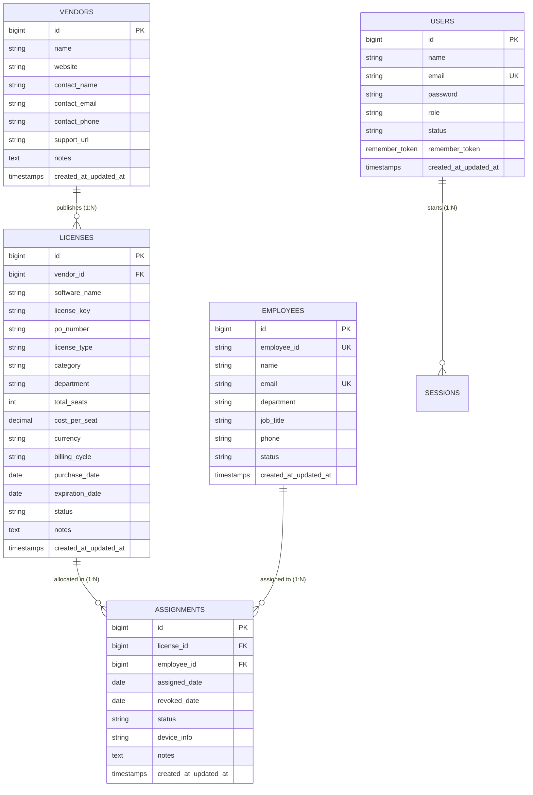

# Milestone 1: Problem Statement, Scope, Database Design & Navigation

> **Project Title:** Digital Software License Catalog & Activation Portal (*LicenseHub*)  
> **Course / Evaluator:** Laravel Project Development  
> **Milestone:** Milestone - 1 (5 Marks)  
> **Submitted By:** Brijesh Akbari (126302)  
> **Repository Branch:** `milestone-1`

---

## Table of Contents
1. [Problem Statement & Scope](#1-problem-statement--scope)
2. [Modules Breakdown](#2-modules-breakdown)
3. [Database & Table Design (Schema & ERD)](#3-database--table-design)
4. [Required Fields Specification](#4-required-fields-specification)
5. [Page & Navigation Design](#5-page--navigation-design)
6. [Milestone 1 Rubric Compliance Checklist](#6-milestone-1-rubric-compliance-checklist)

---

## 1. Problem Statement & Scope

### 1.1 Problem Statement
In modern engineering teams, design studios, and software companies, developers and employees rely on dozens of commercial software licenses (e.g., JetBrains IDEs, Microsoft 365, Adobe Creative Cloud, Docker, Figma Pro). However, without a structured digital catalog and activation workflow, organizations face several practical obstacles:

1. **Lack of a Centralized Software Catalog**: Staff members do not have a single internal portal to discover what software tools the company already owns, leading to duplicate license purchases and unutilized seats (*shelfware*).
2. **Untracked License Keys & Activations**: License activation keys are often scattered across emails, chat channels, or spreadsheets. IT teams lose track of which laptop, workstation, or employee has activated a specific seat.
3. **Unexpected License Expirations**: Software tools expire without warning because validity dates and renewal periods are not actively monitored in a unified catalog.
4. **Data Disorganization**: Without standardized data-management activities (CRUD), adding new software releases, updating seat quotas, modifying vendor terms, or retiring deprecated tools is error-prone.

### 1.2 Practical Scenario & Project Scope
Instead of an overwhelming, bloated enterprise ERP system, this project implements a clean, practical **Digital Software License Catalog & Activation Portal** (*LicenseHub*). 

The portal functions as an internal company app store and activation desk:
- **Software Catalog & Inventory**: Browse, search, filter, and view commercial software tools with tier classifications, seat quotas, and license parameters.
- **Full CRUD Management**: Administrators can publish new software licenses, update seat capacity or activation keys, inspect detailed tool specifications, and archive obsolete records.
- **Seat Activation & Device Binding**: Staff members can claim/activate available license seats for their specific hardware devices (MacBook serial, workstation hostname, VM ID).
- **Publisher & Vendor Directory**: Maintain publisher profiles (JetBrains, Microsoft, Adobe, Figma) with direct support URLs and contact details.
- **Validity & Renewal Tracking**: Monitor active, expiring, and expired licenses with quick renewal actions.

All data-management activities are built strictly using **Laravel Blade templates**, standard Eloquent models, and RESTful CRUD controllers with robust server-side validation.

---

## 2. Modules Breakdown

The portal is structured into **5 cohesive, functional modules** focused squarely on the Software License scenario:

```
┌────────────────────────────────────────────────────────────────────────┐
│            DIGITAL SOFTWARE LICENSE CATALOG & ACTIVATION PORTAL        │
├────────────────────────┬───────────────────────┬───────────────────────┤
│ 1. License Catalog &   │ 2. License Publishing │ 3. Seat Activation &  │
│    Discovery (Browse)  │    & CRUD Inventory   │    Device Binding     │
├────────────────────────┼───────────────────────┼───────────────────────┤
│ 4. Publisher / Vendor  │ 5. Validity & Renewal │ [Auth & Account       │
│    Directory           │    Tracker            │  Security]            │
└────────────────────────┴───────────────────────┴───────────────────────┘
```

### Module Descriptions:

| # | Module Name | Primary Role | Functional Scope & Data Activities |
| :-: | :--- | :--- | :--- |
| **1** | **Software Catalog & Discovery** | Public / Staff Portal | Grid and list view of all licensed software tools. Supports instant search, category filters (Development, Design, Productivity, Cloud, Security), status badges (Active, Expiring Soon, Expired), and seat capacity indicators. |
| **2** | **License Publishing & Inventory (CRUD)** | Admin / IT Desk | Full data-management operations for software licenses: Add new software agreements, view full technical specifications, update seat allocations and license keys, and delete/archive retired software. |
| **3** | **Seat Activation & Device Binding** | Staff & IT Operations | Enables allocating a software license seat to an employee. Binds the activation to a specific device identifier (hostname, hardware serial), prevents over-allocation when seats reach capacity, and logs seat revocations. |
| **4** | **Publisher & Vendor Directory** | Directory / Reference | Stores software publisher profiles (e.g., JetBrains, Microsoft, Adobe) including website URLs, dedicated customer support links, account manager contacts, and licensing terms. |
| **5** | **Validity & Renewal Tracker** | Lifecycle / Monitoring | Visual radar highlighting software licenses approaching expiration within 30 days, complete with quick contract extension actions (+1 Month / +1 Year). |

---

## 3. Database & Table Design

### 3.1 Entity Relationship Diagram (ERD)



---

### 3.2 Data Dictionary (Core Tables & Attributes)

#### Table 1: `licenses` (Software Agreements & Catalog Items)
The primary entity representing licensed software products in the portal.

| Column Name | Data Type | Constraints | Description |
| :--- | :--- | :--- | :--- |
| `id` | BIGINT UNSIGNED | Primary Key, Auto-increment | Unique license identifier |
| `vendor_id` | BIGINT UNSIGNED | Foreign Key &rarr; `vendors.id` | Software publisher / vendor |
| `software_name` | VARCHAR(255) | NOT NULL | Application name (e.g., IntelliJ IDEA, Figma Pro) |
| `license_key` | VARCHAR(255) | NULLABLE | Master activation key, serial, or license code |
| `license_type` | VARCHAR(100) | DEFAULT 'Subscription' | Subscription, Perpetual, Enterprise, Per-Seat |
| `category` | VARCHAR(100) | NULLABLE, INDEX | Category (Development, Design, Productivity, Cloud) |
| `department` | VARCHAR(100) | NULLABLE | Designated department / team |
| `total_seats` | INT | NOT NULL, DEFAULT 1 | Total seat quota purchased |
| `cost_per_seat`| DECIMAL(10,2) | NOT NULL, DEFAULT 0.00 | Cost per seat |
| `currency` | VARCHAR(10) | DEFAULT 'USD' | Currency code (USD, EUR, GBP, INR) |
| `billing_cycle`| VARCHAR(50) | DEFAULT 'annually' | monthly, annually, quarterly, one-time |
| `purchase_date`| DATE | NOT NULL | Purchase or subscription start date |
| `expiration_date`| DATE | NULLABLE | Expiry date (NULL for perpetual licenses) |
| `status` | VARCHAR(50) | DEFAULT 'active', INDEX | Status (`active`, `expiring_soon`, `expired`, `suspended`) |
| `notes` | TEXT | NULLABLE | Special licensing terms or instructions |
| `created_at` / `updated_at` | TIMESTAMP | NULLABLE | Record audit timestamps |

#### Table 2: `vendors` (Software Publishers)
Represents the companies and publishers issuing the software licenses.

| Column Name | Data Type | Constraints | Description |
| :--- | :--- | :--- | :--- |
| `id` | BIGINT UNSIGNED | Primary Key, Auto-increment | Unique vendor ID |
| `name` | VARCHAR(255) | NOT NULL | Publisher name (e.g. JetBrains, Adobe, Microsoft) |
| `website` | VARCHAR(255) | NULLABLE | Official vendor website |
| `contact_name` | VARCHAR(255) | NULLABLE | Vendor representative or account executive |
| `contact_email` | VARCHAR(255) | NULLABLE | Sales or support email |
| `contact_phone` | VARCHAR(50) | NULLABLE | Support phone number |
| `support_url` | VARCHAR(255) | NULLABLE | Direct portal URL for license renewal/helpdesk |
| `notes` | TEXT | NULLABLE | Terms, SLA, contract notes |
| `created_at` / `updated_at` | TIMESTAMP | NULLABLE | Record audit timestamps |

#### Table 3: `assignments` (Seat Activations & Device Bindings)
Tracks individual seat allocations to staff members and their hardware devices.

| Column Name | Data Type | Constraints | Description |
| :--- | :--- | :--- | :--- |
| `id` | BIGINT UNSIGNED | Primary Key, Auto-increment | Unique activation record ID |
| `license_id` | BIGINT UNSIGNED | Foreign Key &rarr; `licenses.id` | Software license allocated |
| `employee_id` | BIGINT UNSIGNED | Foreign Key &rarr; `employees.id` | Employee receiving the seat |
| `assigned_date`| DATE | NOT NULL | Date seat was activated |
| `revoked_date` | DATE | NULLABLE | Date seat was deactivated / returned |
| `status` | VARCHAR(50) | DEFAULT 'active', INDEX | Activation status (`active`, `revoked`) |
| `device_info` | VARCHAR(255) | NULLABLE | Workstation hostname, serial, or hardware MAC |
| `notes` | TEXT | NULLABLE | Activation reason or purpose |
| `created_at` / `updated_at` | TIMESTAMP | NULLABLE | Record audit timestamps |

#### Table 4: `employees` (Staff Members & Users)
Company staff members eligible to activate software licenses.

| Column Name | Data Type | Constraints | Description |
| :--- | :--- | :--- | :--- |
| `id` | BIGINT UNSIGNED | Primary Key, Auto-increment | Employee ID |
| `employee_id` | VARCHAR(100) | UNIQUE, NOT NULL | Staff badge number (`EMP-1001`) |
| `name` | VARCHAR(255) | NOT NULL | Full name |
| `email` | VARCHAR(255) | UNIQUE, NOT NULL | Work email address |
| `department` | VARCHAR(100) | NOT NULL | Department (Engineering, Design, QA) |
| `job_title` | VARCHAR(100) | NOT NULL | Designation |
| `status` | VARCHAR(50) | DEFAULT 'active' | Status (`active`, `inactive`) |
| `created_at` / `updated_at` | TIMESTAMP | NULLABLE | Record audit timestamps |

#### Table 5: `users` (Portal Administrator Accounts)
Authenticated administrators with privileges to perform CRUD actions.

| Column Name | Data Type | Constraints | Description |
| :--- | :--- | :--- | :--- |
| `id` | BIGINT UNSIGNED | Primary Key, Auto-increment | User ID |
| `name` | VARCHAR(255) | NOT NULL | Administrator name |
| `email` | VARCHAR(255) | UNIQUE, NOT NULL | Login email address |
| `password` | VARCHAR(255) | NOT NULL | Encrypted password hash |
| `role` | VARCHAR(50) | DEFAULT 'admin' | Access role (`admin`, `staff`) |
| `remember_token` | VARCHAR(100) | NULLABLE | Remember Me token |
| `created_at` / `updated_at` | TIMESTAMP | NULLABLE | Record audit timestamps |

---

## 4. Required Fields Specification

All interactive forms in the portal enforce strict server-side validation rules in Laravel to guarantee data integrity:

### Form 1: Publish New Software License (`licenses.create`)
- **Required Fields**:
  - `software_name`: String, mandatory, max 255 chars (`required|string|max:255`).
  - `vendor_id`: Dropdown integer, mandatory, must exist in `vendors` (`required|exists:vendors,id`).
  - `license_type`: Selection, mandatory (`required|string|max:100`).
  - `total_seats`: Integer, mandatory, minimum 1 (`required|integer|min:1`).
  - `cost_per_seat`: Numeric, optional/mandatory, minimum 0 (`nullable|numeric|min:0`).
  - `currency`: String, mandatory (`required|string|max:10`).
  - `billing_cycle`: Selection (`required|in:monthly,annually,quarterly,one-time`).
  - `purchase_date`: Valid Date, mandatory (`required|date`).
  - `expiration_date`: Valid Date, required for subscriptions (`nullable|date|after_or_equal:purchase_date`).
  - `status`: Selection (`required|in:active,expiring_soon,expired,suspended`).
- **Optional Fields**: `license_key`, `category`, `notes`.

### Form 2: Modify Software License (`licenses.edit`)
- **Required Fields**:
  - Validates the exact same fields as Form 1 via `PUT /licenses/{id}` to ensure consistency during record modification.

### Form 3: Activate License Seat on Device (`assignments.create`)
- **Required Fields**:
  - `license_id`: Dropdown selection, mandatory, must exist in `licenses` with available seats (`required|exists:licenses,id`).
  - `employee_id`: Dropdown selection, mandatory, must exist in `employees` (`required|exists:employees,id`).
  - `assigned_date`: Valid Date, mandatory (`required|date`).
  - `device_info`: String, mandatory device tag / hostname (`required|string|max:255`).
- **Optional Fields**: `notes`.

### Form 4: Register Software Publisher (`vendors.create`)
- **Required Fields**:
  - `name`: String, mandatory, max 255 chars (`required|string|max:255`).
- **Optional Fields**: `website` (valid URL), `contact_name`, `contact_email` (valid email), `contact_phone`, `support_url` (valid URL), `notes`.

### Form 5: User Sign In / Authentication (`/login`)
- **Required Fields**:
  - `email`: Mandatory valid email format (`required|email`).
  - `password`: Mandatory password string (`required|string`).

---

## 5. Page & Navigation Design

### 5.1 Sitemap & Navigation Flow

The navigation flow is organized intuitively around the catalog and its CRUD operations:

```
                          PORTAL ROOT (/)
                                │
                 ┌──────────────┴──────────────┐
                 ▼                             ▼
         Software Catalog                 About & Portal Guide
          (/licenses)                          (/about)
                 │
                 ├────────────────────────┬────────────────────────┐
                 ▼                        ▼                        ▼
       License Detail & Specs       Publish New Tool        Edit Software Record
        (/licenses/{id})          (/licenses/create)       (/licenses/{id}/edit)
                 │
                 ├────────────────────────┬────────────────────────┐
                 ▼                        ▼                        ▼
        Activate on Device           Vendors Directory        Renewals Radar
       (/assignments/create)            (/vendors)             (/renewals)
```

### 5.2 Navigation Layout Architecture

All pages inherit from a shared Blade layout (`layouts/app.blade.php`) ensuring a consistent, modern user experience:

1. **Persistent Sidebar Navigation (`#appSidebar`)**:
   - **Branding Header**: Logo badge + "LicenseHub Portal".
   - **Catalog Links**: Browse Software Catalog, Seat Activations, Expiration Radar.
   - **Directory Links**: Software Publishers, Staff Directory.
   - **Quick Actions**: Direct buttons for `+ New License` and `Activate Seat`.

2. **Top Bar Header (`.topbar`)**:
   - **Dynamic Breadcrumbs**: Reflects page context (e.g., `Catalog > IntelliJ IDEA > Edit`).
   - **Search Input**: Instant filter across software titles and license keys.
   - **User Profile Pill & Logout**: Displays administrator badge and secure logout action (`POST /logout`).

3. **Blade Template Hierarchy**:
   - `resources/views/layouts/app.blade.php`: Master structural layout.
   - `resources/views/partials/navbar.blade.php`: Responsive topbar and search.
   - `resources/views/partials/alerts.blade.php`: Success/error notification banners (`session('success')`).
   - `resources/views/licenses/index.blade.php`: Searchable Catalog grid and list view.
   - `resources/views/licenses/show.blade.php`: Detailed view of license parameters and active devices.
   - `resources/views/licenses/create.blade.php`: Blade form with validation error indicators.
   - `resources/views/licenses/edit.blade.php`: Pre-filled update form with `@method('PUT')`.

---

## 6. Milestone 1 Rubric Compliance Checklist

| Evaluator Requirement (from Rubric) | Addressed in this Specification | Marks Weightage | Status |
| :--- | :--- | :---: | :---: |
| **Problem statement & scope** | Section 1 defines the real-world software license problem and scopes the Catalog & Activation Portal without bloated ERP overhead. | 1.0 / 1.0 | **Complete** |
| **Modules** | Section 2 breaks down the 5 focused functional modules with roles, inputs, and operational outputs. | 1.0 / 1.0 | **Complete** |
| **Database / table design** | Section 3 provides the Mermaid ERD and 5 complete data dictionary tables with attributes, constraints, and relationships. | 1.0 / 1.0 | **Complete** |
| **Required fields** | Section 4 specifies exact mandatory/optional fields and Laravel validation constraints for all forms. | 1.0 / 1.0 | **Complete** |
| **Page / navigation design** | Section 5 presents the complete visual sitemap, user flow, sidebar/topbar architecture, and Blade hierarchy. | 1.0 / 1.0 | **Complete** |
| **Total Marks** | **Milestone - 1 Evaluation Target** | **5.0 / 5.0** | **Ready for Submission** |
