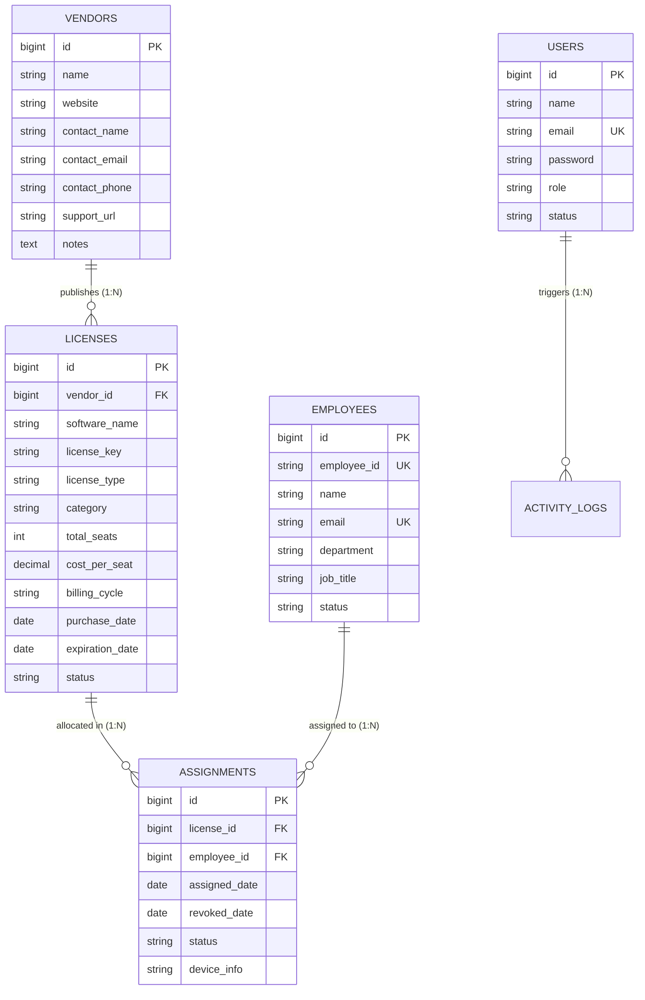

# Software License Management System (*LicenseHub Pro*)
## Milestone - 1 Submission & Project Specification

> **Course / Academic Evaluation:** Laravel Project Development  
> **Student Name:** Brijesh Akbari  
> **Student ID:** 126302  
> **Milestone Evaluation:** **Milestone - 1 (5 Marks)**  
> **Branch:** `milestone-1`

---

## 📋 Milestone - 1 Evaluation Rubric Compliance

This repository branch contains the complete deliverable for **Milestone - 1**, strictly covering all five required criteria:

| Rubric Criteria | Marks | Status | Section in this Document |
| :--- | :---: | :---: | :--- |
| **1. Problem Statement & Scope** | 1 Mark | **Completed** | [Section 1: Problem Statement & Scope](#1-problem-statement--scope) |
| **2. Modules** | 1 Mark | **Completed** | [Section 2: Modules Breakdown](#2-modules-breakdown) |
| **3. Database / Table Design** | 1 Mark | **Completed** | [Section 3: Database & Table Design](#3-database--table-design) |
| **4. Required Fields** | 1 Mark | **Completed** | [Section 4: Required Fields Specification](#4-required-fields-specification) |
| **5. Page / Navigation Design** | 1 Mark | **Completed** | [Section 5: Page & Navigation Design](#5-page--navigation-design) |
| **Total Marks** | **5 / 5 Marks** | **READY FOR EVALUATION** | Full detailed report in [MILESTONE_1_REPORT.md](MILESTONE_1_REPORT.md) |

> *Note to Evaluator: Milestone - 2 (CRUD Operations, Database Connectivity, Models/Migrations, and Dynamic Forms) and Milestone - 3 (Final Working Project Submission) are developed on the `main` branch.*

---

## 1. Problem Statement & Scope

### 1.1 Problem Statement
Organizations and software engineering departments purchase commercial software licenses (e.g., JetBrains IDEs, Microsoft 365, Adobe Creative Cloud, Docker, Figma). Managing software licenses through spreadsheets and manual emails creates severe problems:
- **Shelfware Waste**: 25%–35% of purchased seats remain unassigned or unused, wasting significant budget.
- **Contract Expirations**: Software tools expire without advance warning, halting team development workflows.
- **Publisher Compliance Audits**: Lack of central records of workstation serial numbers leaves institutions vulnerable to severe financial penalties during publisher compliance audits.
- **Hardware Misplacement**: Organizations lose track of which laptop or employee holds expensive perpetual software license keys.

### 1.2 Scope
**LicenseHub Pro** provides a centralized, secure web application designed to:
- Centralize all software agreements, activation keys, seat counts, and costs into an organized catalog.
- Track software publishers, account representatives, and support hotlines.
- Model the allocation of software seats to staff members, tied to hardware device IDs.
- Provide proactive 30-day renewal warnings and contract extension planning.
- Offer clean, responsive navigation across administrative and public portal views.

---

## 2. Modules Breakdown

The system is designed with **10 core functional modules**:

```
┌────────────────────────────────────────────────────────────────────────┐
│                   SOFTWARE LICENSE MANAGEMENT SYSTEM                   │
├────────────────────────┬───────────────────────┬───────────────────────┤
│ 1. Executive Dashboard │ 2. License Inventory  │ 3. Seat Allocation    │
├────────────────────────┼───────────────────────┼───────────────────────┤
│ 4. Vendor Management   │ 5. Staff Directory    │ 6. Renewals Radar     │
├────────────────────────┼───────────────────────┼───────────────────────┤
│ 7. Reports & Analytics │ 8. Audit Activity Log │ 9. System Settings    │
├────────────────────────┴───────────────────────┴───────────────────────┤
│              10. Public Web Portal & Authentication (Home/Auth)        │
└────────────────────────────────────────────────────────────────────────┘
```

1. **Executive Dashboard**: High-level KPI metrics: Active subscriptions, seat utilization rate ($U\%$), total spend, and contracts expiring within 30 days.
2. **Software License Inventory**: Centralized repository of software applications, license keys, categories, and contract dates.
3. **Seat Allocation & Governance**: Mapping individual license seats to employees and hardware device tags.
4. **Vendor Directory**: Catalog of software publishers with support URLs and sales contacts.
5. **Staff Directory**: Corporate employee roster with employee badge IDs (`EMP-XXXX`) and departments.
6. **Renewals Hub**: Proactive contract expiration tracking with urgency indicators.
7. **Reports & Analytics**: Utilization statistics and audit-ready data exports.
8. **Audit Activity Log**: Chronological audit trail of software assignments and changes.
9. **System Settings**: Enterprise customization (company branding, alert lead days, currency).
10. **Public Portal & Authentication**: Public landing page, About Us, Contact & Support form, user registration, and login.

---

## 3. Database & Table Design

### 3.1 Entity Relationship Diagram (ERD)



### 3.2 Relational Data Dictionary

#### 1. `vendors` Table (Software Publishers)
- `id` (BIGINT, PK, Auto-increment) &mdash; Vendor identifier.
- `name` (VARCHAR, NOT NULL) &mdash; Publisher name (e.g. JetBrains, Microsoft).
- `website` (VARCHAR, NULLABLE) &mdash; Official website URL.
- `contact_name` (VARCHAR, NULLABLE) &mdash; Account representative name.
- `contact_email` (VARCHAR, NULLABLE) &mdash; Direct contact email.
- `contact_phone` (VARCHAR, NULLABLE) &mdash; Direct telephone number.
- `support_url` (VARCHAR, NULLABLE) &mdash; Customer support portal link.

#### 2. `licenses` Table (Software Agreements)
- `id` (BIGINT, PK, Auto-increment) &mdash; Unique license identifier.
- `vendor_id` (BIGINT, FK &rarr; `vendors.id`) &mdash; Publishing vendor.
- `software_name` (VARCHAR, NOT NULL) &mdash; Software application title.
- `license_key` (VARCHAR, NULLABLE) &mdash; Serial or product activation key.
- `license_type` (VARCHAR, DEFAULT 'Subscription') &mdash; Subscription, Perpetual, Per Seat, Enterprise.
- `category` (VARCHAR, NULLABLE) &mdash; Development, Design, Productivity, Cloud, Security.
- `total_seats` (INT, NOT NULL, DEFAULT 1) &mdash; Total purchased seat capacity.
- `cost_per_seat` (DECIMAL(10,2), NOT NULL) &mdash; Cost per individual seat.
- `currency` (VARCHAR, DEFAULT 'USD') &mdash; Currency code.
- `billing_cycle` (VARCHAR, DEFAULT 'annually') &mdash; monthly, annually, quarterly, one-time.
- `purchase_date` (DATE, NOT NULL) &mdash; Procurement date.
- `expiration_date` (DATE, NULLABLE) &mdash; Expiration date (NULL for perpetual).
- `status` (VARCHAR, DEFAULT 'active') &mdash; active, expiring_soon, expired, suspended.

#### 3. `employees` Table (Corporate Staff Members)
- `id` (BIGINT, PK, Auto-increment) &mdash; Staff ID.
- `employee_id` (VARCHAR, UNIQUE, NOT NULL) &mdash; Corporate badge identifier (e.g. `EMP-1001`).
- `name` (VARCHAR, NOT NULL) &mdash; Full employee name.
- `email` (VARCHAR, UNIQUE, NOT NULL) &mdash; Corporate email address.
- `department` (VARCHAR, NOT NULL) &mdash; Assigned department (Engineering, Design, IT).
- `job_title` (VARCHAR, NOT NULL) &mdash; Job designation.
- `status` (VARCHAR, DEFAULT 'active') &mdash; active, inactive.

#### 4. `assignments` Table (Seat Allocations)
- `id` (BIGINT, PK, Auto-increment) &mdash; Assignment record ID.
- `license_id` (BIGINT, FK &rarr; `licenses.id`) &mdash; Allocated software.
- `employee_id` (BIGINT, FK &rarr; `employees.id`) &mdash; Staff recipient.
- `assigned_date` (DATE, NOT NULL) &mdash; Allocation date.
- `revoked_date` (DATE, NULLABLE) &mdash; Return / revocation date.
- `status` (VARCHAR, DEFAULT 'active') &mdash; active, revoked.
- `device_info` (VARCHAR, NULLABLE) &mdash; Workstation serial or hostname tag.

#### 5. `users` Table (System Administrators)
- `id` (BIGINT, PK, Auto-increment) &mdash; User ID.
- `name` (VARCHAR, NOT NULL) &mdash; Administrator name.
- `email` (VARCHAR, UNIQUE, NOT NULL) &mdash; Login email address.
- `password` (VARCHAR, NOT NULL) &mdash; Hashed password.
- `role` (VARCHAR, DEFAULT 'admin') &mdash; admin, it_staff.

---

## 4. Required Fields Specification

Every form in the system enforces strict required field constraints indicated by red asterisks (`*`):

| Form Interface | Required (Mandatory) Fields | Optional Fields |
| :--- | :--- | :--- |
| **New License** (`/licenses/create`) | `software_name`, `vendor_id`, `license_type`, `total_seats` ($\ge 1$), `cost_per_seat` ($\ge 0$), `billing_cycle`, `purchase_date`, `expiration_date` | `license_key`, `category`, `notes` |
| **Assign Seat** (`/assignments/create`)| `license_id` (seats $> 0$), `employee_id`, `assigned_date`, `device_info` | `notes` |
| **Register Vendor** (`/vendors/create`) | `name` | `website`, `contact_name`, `contact_email`, `contact_phone`, `support_url`, `notes` |
| **Register Staff** (`/employees/create`) | `employee_id` (unique), `name`, `email` (unique), `department`, `job_title` | `phone`, `status` |
| **Sign In** (`/login`) | `email`, `password` | `remember` session |
| **User Registration** (`/register`) | `name`, `email` (unique), `password` ($\ge 8$ chars), `password_confirmation` | &mdash; |
| **Contact Support** (`/contact`) | `name`, `email`, `category`, `subject`, `message` ($\ge 10$ chars) | &mdash; |

---

## 5. Page & Navigation Design

### 5.1 Sitemap & Navigation Flow

```
                              PUBLIC PORTAL
                     ┌──────────────┴──────────────┐
                     ▼                             ▼
                Home Page (/)              About Us (/about)
                     │                             │
                     ├──────────────┬──────────────┤
                     ▼              ▼              ▼
             Contact (/contact)  Login (/login)  Register (/register)
                                    │
                            [AUTHENTICATION]
                                    │
                                    ▼
                        ADMINISTRATIVE WORKSPACE
                     ┌──────────────┴──────────────┐
                     │                             │
         EXECUTIVE DASHBOARD (/dashboard)  SYSTEM SETTINGS (/settings)
                     │
       ┌─────────────┼─────────────┬─────────────┬─────────────┐
       ▼             ▼             ▼             ▼             ▼
   Licenses     Assignments     Vendors      Employees     Renewals Hub
  (/licenses)  (/assignments)  (/vendors)   (/employees)   (/renewals)
```

### 5.2 Navigation Layout Architecture

The page design uses an ultra-clean, modern **Light Mode Design System** (`public/css/app.css`):

1. **Persistent Sidebar Navigation (`#appSidebar`)**:
   - Brand logo & Pro badge.
   - Categorized sections: Overview, License Management, Directory, Governance & Settings.
   - Footer system monitor indicator and full-width sign-out button.

2. **Top Navigation Bar (`.topbar`)**:
   - Location breadcrumbs (e.g. `Dashboard / Licenses / Add New`).
   - Quick action shortcuts: `Assign Seat` and `+ New License`.
   - Administrator avatar pill and dedicated red **Log Out** button.

3. **Public Header & Footer (`.pub-header`, `.pub-footer`)**:
   - Fixed header with brand icon, navigation links, and auth buttons.
   - Comprehensive footer with legal terms, platform links, and status badge.

---

## 📄 Full Milestone 1 Report
For detailed database schemas, validation dictionaries, and wireframe flows, please see the complete **[MILESTONE_1_REPORT.md](MILESTONE_1_REPORT.md)**.
