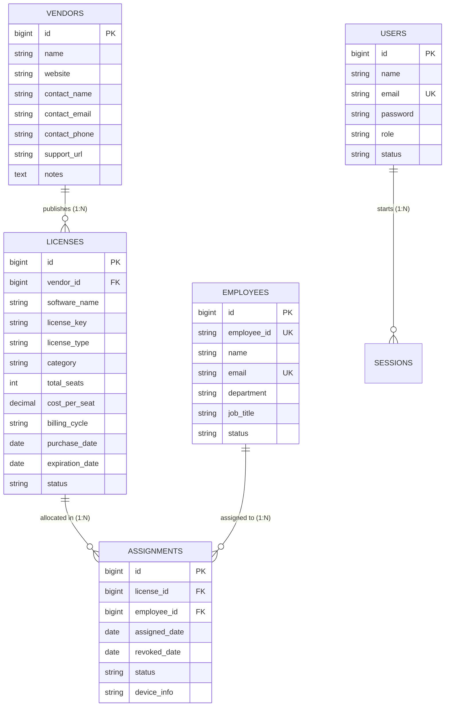

# Digital Software License Catalog & Activation Portal (*LicenseHub*)
## Milestone - 1 Submission & Project Specification

> **Course / Academic Evaluation:** Laravel Project Development  
> **Student Name:** Brijesh Akbari  
> **Student ID:** 126302  
> **Milestone Evaluation:** **Milestone - 1 (5 Marks)**  
> **Branch:** `milestone-1`

---

## 📋 Milestone - 1 Evaluation Rubric Compliance

This repository branch contains the complete deliverable for **Milestone - 1**, strictly covering all five required criteria:

| Rubric Criteria | Marks | Status | Section in this Document |
| :--- | :---: | :---: | :--- |
| **1. Problem Statement & Scope** | 1 Mark | **Completed** | [Section 1: Problem Statement & Scope](#1-problem-statement--scope) |
| **2. Modules** | 1 Mark | **Completed** | [Section 2: Modules Breakdown](#2-modules-breakdown) |
| **3. Database / Table Design** | 1 Mark | **Completed** | [Section 3: Database & Table Design](#3-database--table-design) |
| **4. Required Fields** | 1 Mark | **Completed** | [Section 4: Required Fields Specification](#4-required-fields-specification) |
| **5. Page / Navigation Design** | 1 Mark | **Completed** | [Section 5: Page & Navigation Design](#5-page--navigation-design) |
| **Total Marks** | **5 / 5 Marks** | **READY FOR EVALUATION** | Full detailed report in [MILESTONE_1_REPORT.md](MILESTONE_1_REPORT.md) |

> *Note to Evaluator: Milestone - 2 (CRUD Operations, Database Connectivity, Models/Migrations, and Dynamic Forms) and Milestone - 3 (Final Working Project Submission) are developed on the `main` branch.*

---

## 1. Problem Statement & Scope

### 1.1 Problem Statement
In engineering and design organizations, teams purchase commercial software licenses (e.g., JetBrains IDEs, Microsoft 365, Adobe Creative Cloud, Docker, Figma). Tracking software licenses through spreadsheets and manual emails creates severe problems:
- **Shelfware Waste**: 25%–35% of purchased seats remain unassigned or unused, wasting budget.
- **Untracked License Keys**: Key codes and activation tokens are lost or misplaced across disconnected inboxes.
- **Contract Expirations**: Software tools expire without advance warning, halting team development workflows.
- **Device Misplacement**: IT teams lose track of which laptop, workstation, or employee holds expensive perpetual software licenses.

### 1.2 Scope
**LicenseHub** is designed as a focused **Digital Software License Catalog & Activation Portal** to:
- Present an internal catalog of licensed tools with categories, seat quotas, and license parameters.
- Provide full data-management CRUD capabilities (Add, View, Edit, Delete) for software agreements.
- Allow staff members to activate license seats and bind them to specific device hostnames/hardware tags.
- Maintain a software publisher directory with official support links and contract terms.
- Monitor license validity and upcoming renewals with quick extension actions.

---

## 2. Modules Breakdown

The portal is designed with **5 core functional modules**:

```
┌────────────────────────────────────────────────────────────────────────┐
│            DIGITAL SOFTWARE LICENSE CATALOG & ACTIVATION PORTAL        │
├────────────────────────┬───────────────────────┬───────────────────────┤
│ 1. License Catalog &   │ 2. License Publishing │ 3. Seat Activation &  │
│    Discovery (Browse)  │    & CRUD Inventory   │    Device Binding     │
├────────────────────────┼───────────────────────┼───────────────────────┤
│ 4. Publisher / Vendor  │ 5. Validity & Renewal │ [Auth & Account       │
│    Directory           │    Tracker            │  Security]            │
└────────────────────────┴───────────────────────┴───────────────────────┘
```

1. **Software Catalog & Discovery**: Grid and list view of licensed software tools with instant search, category filters (Development, Design, Productivity, Cloud), and seat capacity indicators.
2. **License Publishing & Inventory (CRUD)**: Data-management operations for software licenses: Add new agreements, inspect tool specifications, update seat allocations/keys, and delete obsolete tools.
3. **Seat Activation & Device Binding**: Allocating a software license seat to an employee and binding it to a hardware device tag while preventing over-allocation.
4. **Publisher / Vendor Directory**: Profiles of software publishers (JetBrains, Microsoft, Adobe) with direct support URLs and contact details.
5. **Validity & Renewal Tracker**: Visual radar highlighting software licenses approaching expiration within 30 days with quick contract extension actions.

---

## 3. Database & Table Design

### 3.1 Entity Relationship Diagram (ERD)



### 3.2 Relational Data Dictionary

#### 1. `licenses` Table (Software Agreements & Catalog Items)
- `id` (BIGINT, PK, Auto-increment) &mdash; Unique license identifier.
- `vendor_id` (BIGINT, FK &rarr; `vendors.id`) &mdash; Publishing vendor.
- `software_name` (VARCHAR, NOT NULL) &mdash; Software application title.
- `license_key` (VARCHAR, NULLABLE) &mdash; Serial or product activation key.
- `license_type` (VARCHAR, DEFAULT 'Subscription') &mdash; Subscription, Perpetual, Per Seat, Enterprise.
- `category` (VARCHAR, NULLABLE) &mdash; Development, Design, Productivity, Cloud, Security.
- `total_seats` (INT, NOT NULL, DEFAULT 1) &mdash; Total purchased seat capacity.
- `cost_per_seat` (DECIMAL(10,2), NOT NULL) &mdash; Cost per individual seat.
- `currency` (VARCHAR, DEFAULT 'USD') &mdash; Currency code.
- `billing_cycle` (VARCHAR, DEFAULT 'annually') &mdash; monthly, annually, quarterly, one-time.
- `purchase_date` (DATE, NOT NULL) &mdash; Procurement date.
- `expiration_date` (DATE, NULLABLE) &mdash; Expiration date (NULL for perpetual).
- `status` (VARCHAR, DEFAULT 'active') &mdash; active, expiring_soon, expired, suspended.

#### 2. `vendors` Table (Software Publishers)
- `id` (BIGINT, PK, Auto-increment) &mdash; Vendor identifier.
- `name` (VARCHAR, NOT NULL) &mdash; Publisher name (e.g. JetBrains, Microsoft).
- `website` (VARCHAR, NULLABLE) &mdash; Official website URL.
- `contact_name` (VARCHAR, NULLABLE) &mdash; Account representative name.
- `contact_email` (VARCHAR, NULLABLE) &mdash; Direct contact email.
- `contact_phone` (VARCHAR, NULLABLE) &mdash; Direct telephone number.
- `support_url` (VARCHAR, NULLABLE) &mdash; Customer support portal link.

#### 3. `assignments` Table (Seat Activations & Device Bindings)
- `id` (BIGINT, PK, Auto-increment) &mdash; Assignment record ID.
- `license_id` (BIGINT, FK &rarr; `licenses.id`) &mdash; Allocated software.
- `employee_id` (BIGINT, FK &rarr; `employees.id`) &mdash; Staff recipient.
- `assigned_date` (DATE, NOT NULL) &mdash; Allocation date.
- `revoked_date` (DATE, NULLABLE) &mdash; Return / revocation date.
- `status` (VARCHAR, DEFAULT 'active') &mdash; active, revoked.
- `device_info` (VARCHAR, NULLABLE) &mdash; Workstation serial or hostname tag.

#### 4. `employees` Table (Corporate Staff Members)
- `id` (BIGINT, PK, Auto-increment) &mdash; Staff ID.
- `employee_id` (VARCHAR, UNIQUE, NOT NULL) &mdash; Corporate badge identifier (e.g. `EMP-1001`).
- `name` (VARCHAR, NOT NULL) &mdash; Full employee name.
- `email` (VARCHAR, UNIQUE, NOT NULL) &mdash; Corporate email address.
- `department` (VARCHAR, NOT NULL) &mdash; Assigned department (Engineering, Design, IT).
- `job_title` (VARCHAR, NOT NULL) &mdash; Job designation.
- `status` (VARCHAR, DEFAULT 'active') &mdash; active, inactive.

#### 5. `users` Table (System Administrators)
- `id` (BIGINT, PK, Auto-increment) &mdash; User ID.
- `name` (VARCHAR, NOT NULL) &mdash; Administrator name.
- `email` (VARCHAR, UNIQUE, NOT NULL) &mdash; Login email address.
- `password` (VARCHAR, NOT NULL) &mdash; Hashed password.
- `role` (VARCHAR, DEFAULT 'admin') &mdash; admin, staff.

---

## 4. Required Fields Specification

Every form in the system enforces strict required field constraints indicated by red asterisks (`*`):

| Form Interface | Required (Mandatory) Fields | Optional Fields |
| :--- | :--- | :--- |
| **Publish License** (`/licenses/create`) | `software_name`, `vendor_id`, `license_type`, `total_seats` ($\ge 1$), `cost_per_seat` ($\ge 0$), `billing_cycle`, `purchase_date`, `expiration_date` | `license_key`, `category`, `notes` |
| **Modify License** (`/licenses/{id}/edit`) | `software_name`, `vendor_id`, `license_type`, `total_seats`, `cost_per_seat`, `billing_cycle`, `purchase_date`, `expiration_date` | `license_key`, `category`, `notes` |
| **Activate Seat on Device** (`/assignments/create`)| `license_id` (seats $> 0$), `employee_id`, `assigned_date`, `device_info` | `notes` |
| **Register Publisher** (`/vendors/create`) | `name` | `website`, `contact_name`, `contact_email`, `contact_phone`, `support_url`, `notes` |
| **Sign In** (`/login`) | `email`, `password` | `remember` session |

---

## 5. Page & Navigation Design

### 5.1 Sitemap & Navigation Flow

```
                          PORTAL ROOT (/)
                                │
                 ┌──────────────┴──────────────┐
                 ▼                             ▼
         Software Catalog                 About & Portal Guide
          (/licenses)                          (/about)
                 │
                 ├────────────────────────┬────────────────────────┐
                 ▼                        ▼                        ▼
       License Detail & Specs       Publish New Tool        Edit Software Record
        (/licenses/{id})          (/licenses/create)       (/licenses/{id}/edit)
                 │
                 ├────────────────────────┬────────────────────────┐
                 ▼                        ▼                        ▼
        Activate on Device           Vendors Directory        Renewals Radar
       (/assignments/create)            (/vendors)             (/renewals)
```

### 5.2 Navigation Layout Architecture

All pages inherit from a shared Blade layout (`layouts/app.blade.php`):

1. **Persistent Sidebar Navigation (`#appSidebar`)**:
   - Branding Header: Logo icon + "LicenseHub Portal".
   - Navigation links: Software Catalog, Seat Activations, Expiration Radar, Publishers Directory.
   - Quick action shortcuts: `+ New License` and `Activate Seat`.

2. **Top Navigation Bar (`.topbar`)**:
   - Breadcrumbs navigation (e.g. `Catalog / IntelliJ IDEA / Edit`).
   - Quick search input for tools and license keys.
   - User profile badge with 1-click logout action (`POST /logout`).

---

## 📄 Full Milestone 1 Report
For complete database schemas, validation rules, and architectural details, refer to the full **[MILESTONE_1_REPORT.md](MILESTONE_1_REPORT.md)**.
